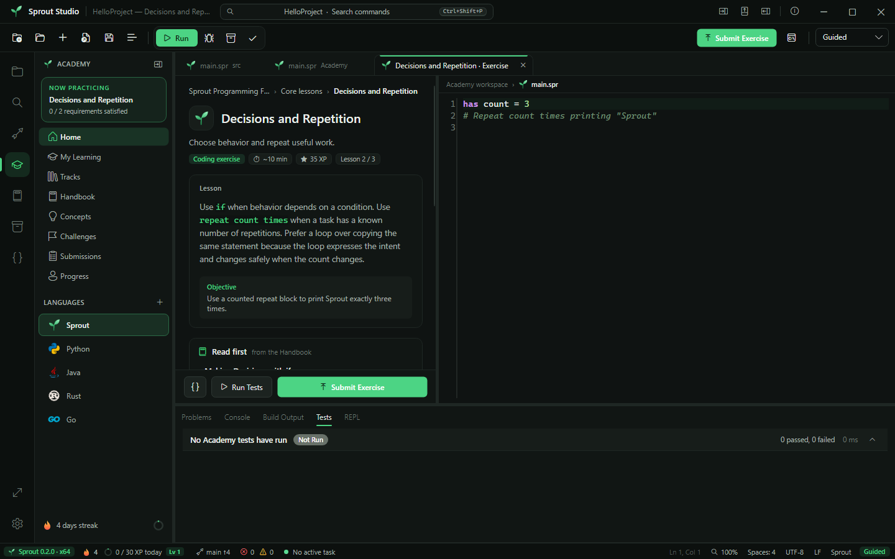
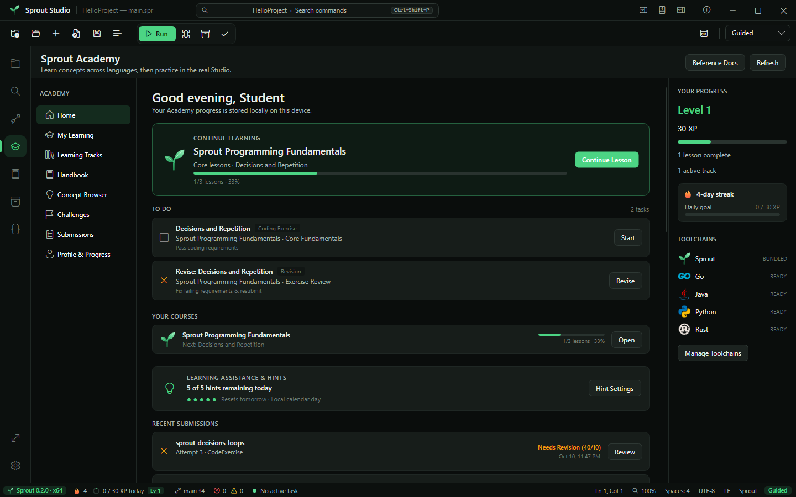

# Sprout Studio

**An IDE that teaches you to code while you write it.** Sprout Studio is a Windows IDE for the Sprout programming language, with a built-in Academy. You learn a concept, read a short guide, practice in a real editor, and see your progress follow you everywhere in the app.



## Download

Get the latest release from the [Releases page](https://github.com/ayzeeyan/sprout-studio/releases/latest):

- **`SproutStudio-Setup-x64.exe`**: the installer. It installs for your user account only (no admin rights) into `%LOCALAPPDATA%\Programs\Sprout Studio`, adds Start Menu shortcuts, and can open `.spr` files.
- **`SproutStudio-Portable-x64.zip`**: a portable copy. Extract it anywhere and run `SproutStudio.exe`.
- **`SHA256SUMS.txt`**: checksums for verifying your download.

Requires 64-bit Windows 10 or 11. Everything is bundled, including the .NET runtime, the Sprout engine, and Python 3.13, so there is nothing else to install. Sprout Studio is in **alpha**: see the [release notes](RELEASE_NOTES.md) and the [roadmap to 1.0](docs/roadmap.md).

## Features

**Learn**
- **Academy** tracks for Sprout, Python, Java, Rust, and Go, with coding exercises checked by the real engine and toolchains.
- **Handbook**: short, plain-language guides with a one-click switch to the full reference docs. Every code sample is tested.
- **Learn inspector**: detects the concepts in the file you're editing, explains them, and compares them across languages.
- Streaks, a daily XP goal, levels, achievements, and a 12-week activity heatmap. You can turn them all off.

**Build**
- Three syntax styles for the same language: Guided (plain English), Structured, and Advanced.
- Engine-backed completion, hover, outline, go-to-definition, formatting, and recorded time-travel debugging.
- Syntax highlighting for 13 languages, and run/build support for Rust, Go, Python, and Java projects.
- Project search, Git source control, Python and Sprout package management, a REPL, and a Canvas for graphics.
- Five accent themes, zen mode, editor zoom, and a command palette for everything.



## Try Sprout from source

Install a current Rust toolchain, clone the repository, and run:

```powershell
cargo run -p sprout-cli -- run examples/hello.spr
```

Expected output:

```text
Hello Sprout
Hello Sprout
Hello Sprout
```

Validate without executing:

```powershell
cargo run -p sprout-cli -- check examples/hello.spr
```

Run the other syntax profiles:

```powershell
cargo run -p sprout-cli -- run --profile structured examples/structured.spr
cargo run -p sprout-cli -- run --profile advanced examples/advanced.spr
```

Prepare the pinned development runtime and run the Python example:

```powershell
powershell.exe -NoProfile -ExecutionPolicy Bypass -File tools/prepare-python-runtime.ps1
cargo run -p sprout-cli -- run examples/python.spr
```

Create and run a complete project:

```powershell
cargo run -p sprout-cli -- new HelloSprout --template guided
cargo run -p sprout-cli -- run HelloSprout
```

Python packages declared under `[python]` in `sprout.toml` are installed only into that project's `.sprout/python` directory:

```powershell
cargo run -p sprout-cli -- python sync HelloSprout --python runtime/python-3.13.14-win-x64/python.exe
```

## Develop

```powershell
cargo fmt --all --check
cargo clippy --workspace --all-targets -- -D warnings
cargo test --workspace
dotnet run --project studio/tests/SproutStudio.Tests/SproutStudio.Tests.csproj
dotnet build studio/SproutStudio.sln -c Debug -p:Platform=x64
```

## Documentation

| Topic | Page |
| --- | --- |
| Using Studio | [docs/studio.md](docs/studio.md), [docs/advanced-ide.md](docs/advanced-ide.md) |
| The Academy and Handbook | [docs/academy.md](docs/academy.md) |
| The Sprout language | [docs/grammar.md](docs/grammar.md), [docs/syntax-profiles.md](docs/syntax-profiles.md), [docs/stdlib.md](docs/stdlib.md) |
| Projects, packages, and Python | [docs/projects.md](docs/projects.md), [docs/python-interop.md](docs/python-interop.md) |
| Other languages | [docs/toolchains.md](docs/toolchains.md) |
| How it's built | [docs/architecture.md](docs/architecture.md), [docs/building.md](docs/building.md) |
| What's next | [docs/roadmap.md](docs/roadmap.md) |

The repository contains a Rust language engine, project system, CLI, and versioned C ABI, plus the C#/.NET 10/Avalonia 12 desktop application.

## Release

Create the validated self-contained Windows release, installer, portable archive, and SHA-256 checksums with:

```powershell
powershell.exe -NoProfile -ExecutionPolicy Bypass -File scripts/build-release.ps1
```

Release and installer details are in [docs/releasing.md](docs/releasing.md).

## License

MIT
